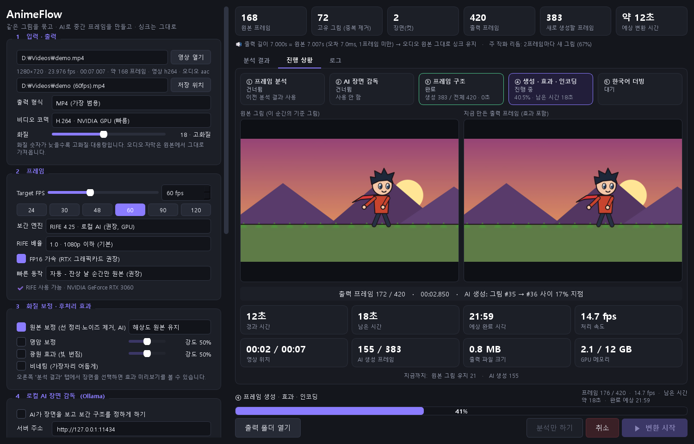
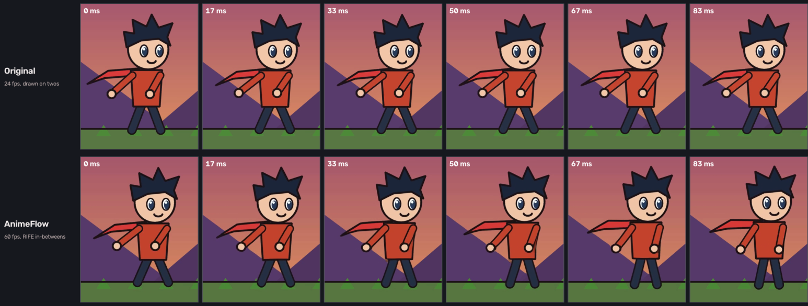
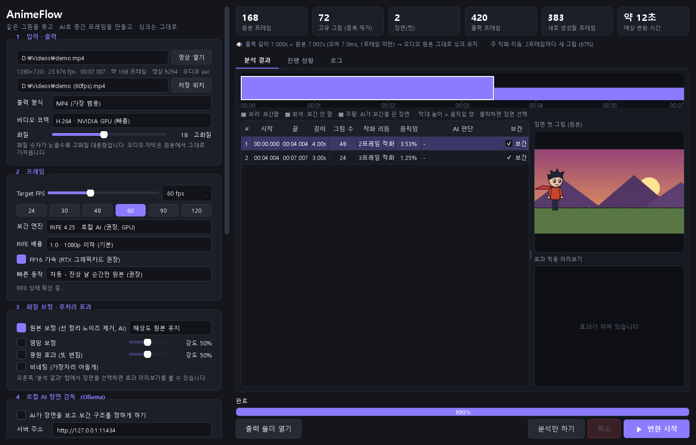

# AnimeFlow

[English](README.md) · [한국어](README.ko.md) · **日本語** · [简体中文](README.zh-CN.md)

フレーム数の少ないアニメを、自分のPCでより滑らかに・きれいにするツールです。
アニメは通常 2〜3 コマごとに絵が変わります（2コマ・3コマ打ち）。AnimeFlow は実際の作画を検出し、
その間のフレームをローカル AI（RIFE）で生成し、元の作画もきれいに補正します。
**動画の長さは変わらないので、音声・字幕の同期はずれません。**

> アプリの画面は現在韓国語です。必要なボタンはすべてこのガイドで説明しています。

## 機能

- **24〜120fps へのフレーム補間** — RIFE 4.25、自分の GPU でローカル実行
- **元の長さを維持** — 出力フレーム k を正確に k/FPS 秒に配置、音声はそのままコピー
- **プログラムによる解析（AI 不要）** — 同じ絵のグループ化、カット検出、動き量の測定
- **速い動きの保護** — ポーズが大きく変わる瞬間の残像を防止（4 モード、下記参照）
- **24p タイミング復元** — 24fps のアニメを 30fps にした動画の不規則な間隔を修正
- **原画補正** — Real-ESRGAN AnimeVideo v3 でにじんだ線や圧縮ノイズを除去、1080p / 1440p アップスケールも可能
- **進捗画面** — 残り時間、現在の処理、生成中フレームのプレビュー
- **出力** — MP4 / MKV / MOV / WebM（NVIDIA ハードウェアエンコード）
- オプション：ローカル AI シーン監督（Ollama）、立体ライティング（実験的）、韓国語 AI 吹き替え（実験的）

*1/60 秒間隔の同じ瞬間。上：2 コマ打ちの元の 24fps — 同じ絵が続いてから一気に変わる。
下：AnimeFlow 60fps — 毎フレーム新しい中割り。（この README 用に描いたデモ映像）*

## 必要環境

| | |
|---|---|
| OS | Windows 10 / 11（64 ビット） |
| GPU | NVIDIA GeForce（RTX 推奨、VRAM 6GB 以上）。RTX 3060 12GB で動作確認 |
| Python | **3.12** — https://www.python.org/downloads/ |
| 空き容量 | 約 8GB（PyTorch 約 5GB + モデル・FFmpeg 約 350MB） |

## インストール（初回のみ）

1. **Python 3.12** をインストール。インストーラーで **「Add python.exe to PATH」** に必ずチェック。
2. AnimeFlow をダウンロード：緑の **Code** ボタン → **Download ZIP** → 好きな場所に展開
   （または `git clone https://github.com/O3O-2022/AnimeFlow.git`）
3. **`setup.bat`** をダブルクリック。ライブラリ、PyTorch（CUDA）、AI モデル、FFmpeg をすべて自動でインストールします（10〜30 分）。
   ダウンロードに失敗したら `setup.bat` をもう一度実行してください。完了した手順はスキップされます。

## 使い方

1. **`run.bat`** をダブルクリック
2. **1 입력 · 출력**（入力・出力）— **영상 열기**（動画を開く）を押すか、動画をウィンドウにドラッグ。
   **저장 위치**（保存先）で出力ファイルを指定
3. **2 프레임**（フレーム）— 目標 FPS（24〜120）と **빠른 동작**（速い動き）モードを選択
4. **3 화질 보정**（画質補正）— 作画をきれいにするなら **원본 보정**（原画補正）にチェック（1080p / 1440p も選択可）
5. **▶ 변환 시작**（変換開始）— 進捗タブで残り時間とプレビューを確認

### 速い動きのモード

| モード（画面の表記） | 動作 | おすすめ |
|---|---|---|
| **자동** — 自動（既定） | 残像が出る瞬間だけ元の絵を維持 | ほとんどの動画 |
| **끊김 없이** — 常に補間 | すべて補間。最も滑らかだが速いアクションで残像 | ゆっくりした場面 |
| **잔상 없이** — 残像なし | 少しでも危険なら元の絵を維持 | きれいさ優先（ときどき止まる） |
| **선 안정 우선** — 線の安定優先 | 目・口・髪など小さな動きだけ補間 | 原作の雰囲気そのまま。**24fps** と併用 |

**おすすめ設定：** 滑らかなアクション → *60fps + 自動*。原作に近く → *24fps + 線の安定優先 + 原画補正*。

## 追加機能（オプション）

- **AI シーン監督**（4 番の欄）：[Ollama](https://ollama.com/download) をインストールし `ollama pull qwen2.5vl:7b` を実行、チェックボックスをオン。
  AI がシーンごとに補間方法を決めます。
- **立体ライティング**（実験的、ウィンドウ最下部）：深度推定でセル影とリムライトを加えます。
- **韓国語 AI 吹き替え**（実験的、5 番の欄）：追加の Python 環境が 2 つ必要です —
  [技術ノート（韓国語）](docs/technical-notes.ko.md#한국어-ai-더빙용-환경-선택) を参照。
  **個人視聴のみ**：音声モデル（XTTS v2）は非商用ライセンスで、キャラクター音声の複製結果を共有・販売してはいけません。

## トラブルシューティング

| 症状 | 対処 |
|---|---|
| `Python 3.12 was not found` | Python 3.12 をインストールして `setup.bat` を再実行 |
| モデルのダウンロード失敗 | `setup.bat` を再実行、または下の手動インストール |
| 「RIFE 모델 파일 없음」（RIFE モデルがない） | `third_party/Practical-RIFE/train_log/flownet.pkl` がない → `setup.bat` を再実行 |
| 非常に遅い / CUDA が使えない | NVIDIA ドライバーを更新、NVIDIA の GPU か確認 |

手動インストール（自動ダウンロードができない場合）

| 項目 | 置く場所 |
|---|---|
| [Practical-RIFE](https://github.com/hzwer/Practical-RIFE) のコード | `third_party/Practical-RIFE/` |
| RIFE 4.25 モデル（[Google Drive](https://drive.google.com/file/d/1ZKjcbmt1hypiFprJPIKW0Tt0lr_2i7bg/view)）— `flownet.pkl, IFNet_HDv3.py, RIFE_HDv3.py, refine.py` | `third_party/Practical-RIFE/train_log/` |
| [Depth-Anything-V2](https://github.com/DepthAnything/Depth-Anything-V2) のコード | `third_party/Depth-Anything-V2/` |
| [depth_anything_v2_vits.pth](https://huggingface.co/depth-anything/Depth-Anything-V2-Small/resolve/main/depth_anything_v2_vits.pth) | `third_party/Depth-Anything-V2/checkpoints/` |
| [realesr-animevideov3.pth](https://github.com/xinntao/Real-ESRGAN/releases/download/v0.2.5.0/realesr-animevideov3.pth) | `third_party/restore/` |
| [FFmpeg 8.1](https://github.com/BtbN/FFmpeg-Builds/releases/download/latest/ffmpeg-n8.1-latest-win64-gpl-8.1.zip) の `bin/*.exe` | `tools/ffmpeg/` |

## 仕組み

1. **解析**（AI なし）— 同じ絵をまとめ、各作画の開始・終了時刻を記録、カット検出、動き量の測定
2. **計画** — 出力フレーム *k* は正確に *k/FPS* 秒。どのフレームをコピーし、どれを生成するか決定
3. **生成** — RIFE が中間フレームを生成（変化した領域だけを処理するため会話シーンは 5〜11 倍高速）
4. **効果** — 陰影・光源効果（オプション）を最終フレームに適用
5. **エンコード** — FFmpeg、元の音声・字幕をそのままコピー

詳細（韓国語）：[docs/technical-notes.ko.md](docs/technical-notes.ko.md)

## 使用しているプロジェクト

`setup.bat` がダウンロードする外部プロジェクト（このリポジトリには含まれません）：
[Practical-RIFE](https://github.com/hzwer/Practical-RIFE) (MIT) ·
[Depth Anything V2](https://github.com/DepthAnything/Depth-Anything-V2) (Apache-2.0) ·
[Real-ESRGAN](https://github.com/xinntao/Real-ESRGAN) (BSD-3-Clause) ·
[FFmpeg](https://ffmpeg.org/)（[BtbN](https://github.com/BtbN/FFmpeg-Builds) の GPL ビルド） ·
[PySide6](https://doc.qt.io/qtforpython-6/) · [PyTorch](https://pytorch.org/) · [spandrel](https://github.com/chaiNNer-org/spandrel)。
吹き替え（オプション）：[Coqui XTTS v2](https://huggingface.co/coqui/XTTS-v2)（CPML、非商用） ·
[Whisper](https://github.com/openai/whisper) · [Demucs](https://github.com/facebookresearch/demucs) · [Seed-VC](https://github.com/Plachtaa/seed-vc)。

使用する権利のある動画だけを処理してください。

## ライセンス

AnimeFlow は [MIT ライセンス](LICENSE) で公開されています。
上記の外部プロジェクトとモデルは、それぞれのライセンスに従います（例：XTTS v2 は非商用のみ）。
