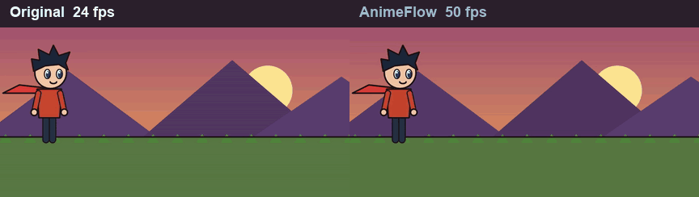
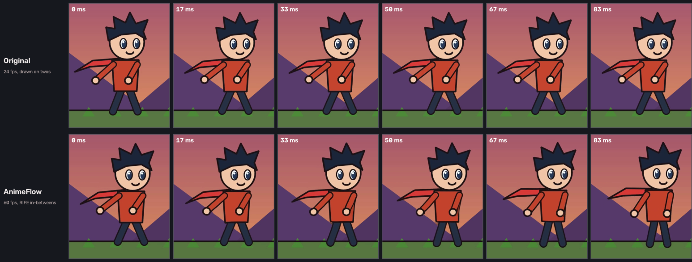
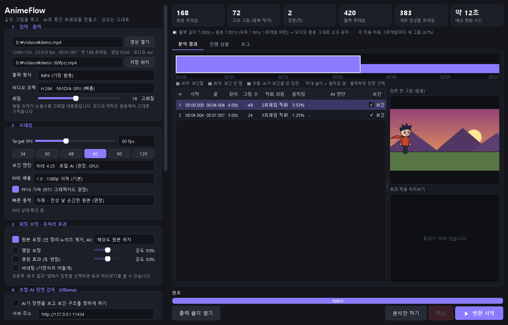
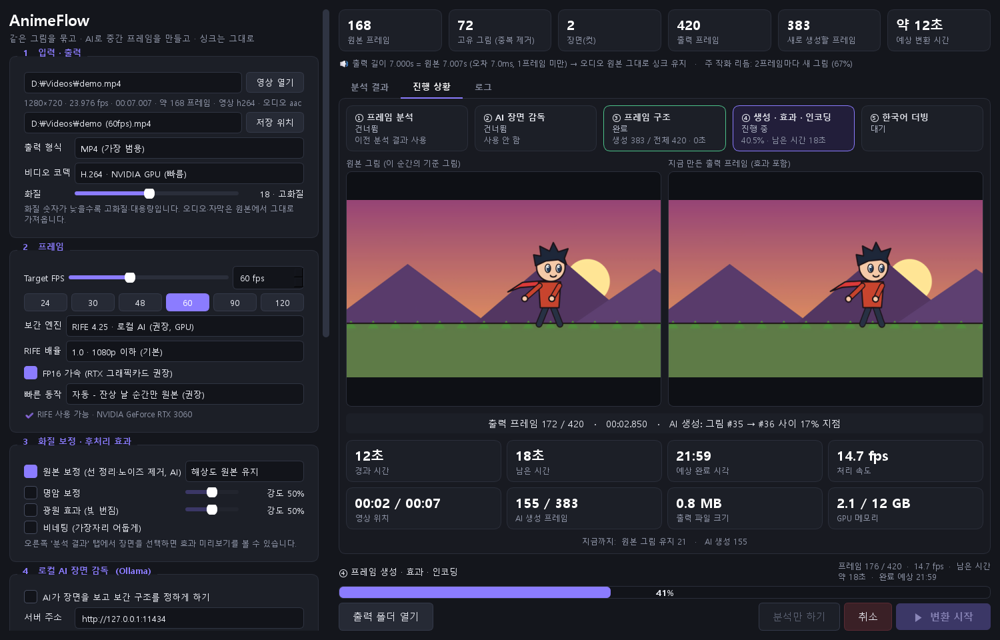

# AnimeFlow

[English](README.md) · [한국어](README.ko.md) · [日本語](README.ja.md) · **简体中文**

在自己的电脑上让低帧率动画更流畅、更干净的工具。
动画通常每 2～3 帧才换一张画（“一拍二”“一拍三”）。AnimeFlow 会找出真正的原画，用本地 AI（RIFE）
生成中间帧，还可以清理原画的线条与噪点。**视频长度保持不变，因此声音和字幕不会错位。**

> 目前软件界面为韩语。本指南会说明所有需要用到的按钮。

*左：原始 24fps（一拍二／一拍三）。右：AnimeFlow。GIF 最多只能以 50fps 播放，所以此演示为 50fps；软件本身最高支持 120fps。*

## 功能

- **补帧到 24～120 fps** — RIFE 4.25，在你的显卡上本地运行
- **保持原始时长** — 第 k 个输出帧精确放在 k/FPS 秒，音频原样复制
- **程序分析（无需 AI）** — 合并重复帧、检测镜头切换、测量运动量
- **快速动作保护** — 在姿势大幅变化时避免残影（4 种模式，见下文）
- **24p 节奏还原** — 修正 24fps 动画被转成 30fps 后不均匀的帧间隔
- **原画修复** — Real-ESRGAN AnimeVideo v3 清理模糊线条和压缩噪点，可选放大到 1080p / 1440p
- **进度界面** — 剩余时间、当前任务、正在生成的帧的实时预览
- **输出** — MP4 / MKV / MOV / WebM（NVIDIA 硬件编码）
- 可选：本地 AI 场景导演（Ollama）、立体光照（实验性）、韩语 AI 配音（实验性）

*间隔 1/60 秒的相同时刻。上：一拍二的原始 24fps — 同一张画持续后突然跳变。
下：AnimeFlow 60fps — 每帧都有新的中间画。（为本 README 绘制的演示视频）*

## 系统要求

| | |
|---|---|
| 系统 | Windows 10 / 11（64 位） |
| 显卡 | NVIDIA GeForce（推荐 RTX，显存 6GB 以上）。已在 RTX 3060 12GB 上测试 |
| Python | **3.12** — https://www.python.org/downloads/ |
| 磁盘空间 | 约 8GB（PyTorch 约 5GB + 模型和 FFmpeg 约 350MB） |

## 安装（仅需一次）

1. 安装 **Python 3.12**。安装界面中务必勾选 **“Add python.exe to PATH”**。
2. 下载 AnimeFlow：绿色 **Code** 按钮 → **Download ZIP** → 解压到任意位置
   （或 `git clone https://github.com/O3O-2022/AnimeFlow.git`）
3. 双击 **`setup.bat`**。它会自动安装所有内容（10～30 分钟）：Python 库、PyTorch（CUDA）、AI 模型和 FFmpeg。
   如果下载失败，再运行一次 `setup.bat` 即可，已完成的步骤会被跳过。

## 使用方法

1. 双击 **`run.bat`**
2. **1 입력 · 출력**（输入・输出）— 点击 **영상 열기**（打开视频）或把视频拖到窗口中。
   用 **저장 위치**（保存位置）指定输出文件
3. **2 프레임**（帧）— 选择目标 FPS（24～120）和 **빠른 동작**（快速动作）模式
4. **3 화질 보정**（画质修复）— 想让画面更干净就勾选 **원본 보정**（原画修复），可选 1080p / 1440p
5. 点击 **▶ 변환 시작**（开始转换）— 在进度页查看剩余时间和预览

### 快速动作模式

| 模式（界面文字） | 作用 | 适用 |
|---|---|---|
| **자동** — 自动（默认） | 只在会产生残影的瞬间保留原画 | 大多数视频 |
| **끊김 없이** — 始终补帧 | 全部补帧，最流畅，但快速动作会有残影 | 慢节奏场景 |
| **잔상 없이** — 无残影 | 只要有风险就保留原画 | 画面干净优先（偶尔停顿） |
| **선 안정 우선** — 线条稳定优先 | 只对眼睛、嘴、头发等小动作补帧 | 最接近原作，配合 **24fps** 使用 |

**推荐设置：** 流畅的动作 → *60fps + 自动*。贴近原作 → *24fps + 线条稳定优先 + 原画修复*。

## 可选功能

- **AI 场景导演**（第 4 栏）：安装 [Ollama](https://ollama.com/download)，运行 `ollama pull qwen2.5vl:7b`，然后勾选复选框。
  AI 会为每个场景决定补帧方式。
- **立体光照**（实验性，窗口最下方）：用深度估计加入赛璐璐阴影和轮廓光。
- **韩语 AI 配音**（实验性，第 5 栏）：需要另外两个 Python 环境 —
  见[技术笔记（韩语）](docs/technical-notes.ko.md#한국어-ai-더빙용-환경-선택)。
  **仅限个人观看**：语音模型（XTTS v2）为非商业许可，克隆角色声音的结果不得分享或出售。

## 常见问题

| 问题 | 解决办法 |
|---|---|
| `Python 3.12 was not found` | 安装 Python 3.12 后重新运行 `setup.bat` |
| 模型下载失败 | 重新运行 `setup.bat`，或使用下方的手动安装 |
| “RIFE 모델 파일 없음”（缺少 RIFE 模型） | 缺少 `third_party/Practical-RIFE/train_log/flownet.pkl` → 重新运行 `setup.bat` |
| 非常慢 / 无法使用 CUDA | 更新 NVIDIA 驱动，确认使用的是 NVIDIA 显卡 |

手动安装（自动下载失败时）

| 项目 | 放置位置 |
|---|---|
| [Practical-RIFE](https://github.com/hzwer/Practical-RIFE) 代码 | `third_party/Practical-RIFE/` |
| RIFE 4.25 模型（[Google Drive](https://drive.google.com/file/d/1ZKjcbmt1hypiFprJPIKW0Tt0lr_2i7bg/view)）— `flownet.pkl, IFNet_HDv3.py, RIFE_HDv3.py, refine.py` | `third_party/Practical-RIFE/train_log/` |
| [Depth-Anything-V2](https://github.com/DepthAnything/Depth-Anything-V2) 代码 | `third_party/Depth-Anything-V2/` |
| [depth_anything_v2_vits.pth](https://huggingface.co/depth-anything/Depth-Anything-V2-Small/resolve/main/depth_anything_v2_vits.pth) | `third_party/Depth-Anything-V2/checkpoints/` |
| [realesr-animevideov3.pth](https://github.com/xinntao/Real-ESRGAN/releases/download/v0.2.5.0/realesr-animevideov3.pth) | `third_party/restore/` |
| [FFmpeg 8.1](https://github.com/BtbN/FFmpeg-Builds/releases/download/latest/ffmpeg-n8.1-latest-win64-gpl-8.1.zip) 中的 `bin/*.exe` | `tools/ffmpeg/` |

## 工作原理

1. **分析**（不用 AI）— 合并相同的画面，记录每张原画的开始・结束时间，检测镜头切换，测量运动量
2. **规划** — 第 *k* 个输出帧精确位于 *k/FPS* 秒，决定哪些帧复制、哪些帧生成
3. **生成** — RIFE 生成中间帧（只处理变化区域，对话场景快 5～11 倍）
4. **效果** — 可选的明暗・光源效果，作用于最终帧
5. **编码** — FFmpeg，原始音频和字幕原样复制

详细说明（韩语）：[docs/technical-notes.ko.md](docs/technical-notes.ko.md)

## 使用的项目

由 `setup.bat` 下载的外部项目（不包含在本仓库中）：
[Practical-RIFE](https://github.com/hzwer/Practical-RIFE) (MIT) ·
[Depth Anything V2](https://github.com/DepthAnything/Depth-Anything-V2) (Apache-2.0) ·
[Real-ESRGAN](https://github.com/xinntao/Real-ESRGAN) (BSD-3-Clause) ·
[FFmpeg](https://ffmpeg.org/)（[BtbN](https://github.com/BtbN/FFmpeg-Builds) 的 GPL 构建） ·
[PySide6](https://doc.qt.io/qtforpython-6/) · [PyTorch](https://pytorch.org/) · [spandrel](https://github.com/chaiNNer-org/spandrel)。
配音（可选）：[Coqui XTTS v2](https://huggingface.co/coqui/XTTS-v2)（CPML，非商业） ·
[Whisper](https://github.com/openai/whisper) · [Demucs](https://github.com/facebookresearch/demucs) · [Seed-VC](https://github.com/Plachtaa/seed-vc)。

请只处理你有权使用的视频。

## 许可证

AnimeFlow 以 [MIT 许可证](LICENSE) 发布。
上述外部项目和模型遵循各自的许可证（例如 XTTS v2 仅限非商业用途）。
